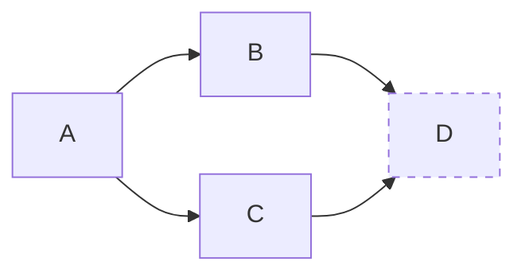
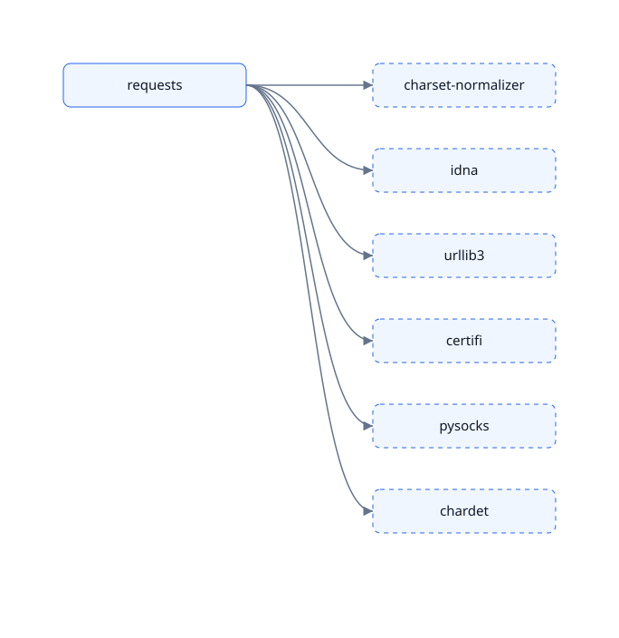
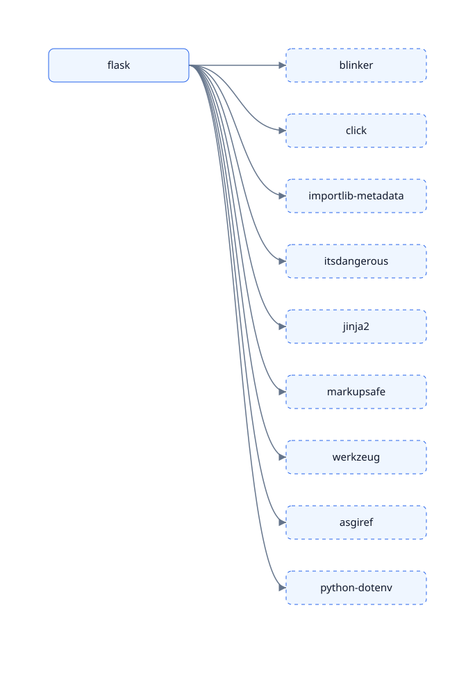
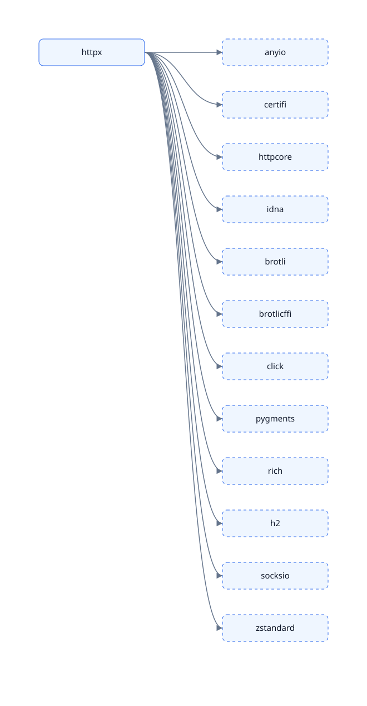

# Вариант 15. Анализ зависимостей пакетов Python

## 1. Общее описание

Консольная программа читает настройки из TOML, получает зависимости через
JSON API PyPI и строит граф обходом BFS без рекурсии. Поддерживаются
тестовый репозиторий, ограничение глубины и циклические зависимости.
Пакет добавляется в очередь один раз, общие зависимости не дублируются.
Глубина исходного пакета равна 0. Узлы на максимальной глубине включаются
в граф, но их зависимости не запрашиваются.

Обычный запуск выводит список смежности и сохраняет два файла:
текст диаграммы Mermaid (`.mmd`) и изображение SVG (`.svg`).
Стрелка направлена от пакета к его зависимости. Пунктирная рамка означает,
что зависимости узла не раскрыты из-за ограничения глубины.
Циклы и петли сохраняются в обоих представлениях.
SVG формируется стандартной библиотекой Python из того же графа,
что и Mermaid; внешние средства рендеринга не требуются.
Расположение узлов в SVG может отличаться от расположения в Mermaid.

Режим `--reverse PACKAGE` выводит прямые и транзитивные обратные
зависимости. Для этого рёбра разворачиваются и используется тот же BFS.
Сам искомый пакет исключается из результата, в том числе при цикле.
В этом режиме файлы визуализации не создаются.

Запрос метаданных: `<repository>/pypi/<package>/json`.
Программа извлекает имена из `info.requires_dist`, включая extras
и условные зависимости. Имена приводятся к нижнему регистру,
последовательности `.`, `_`, `-` заменяются на `-`.
Условия среды не вычисляются, ограничения версий не разрешаются.
Граф содержит объявленные связи актуальных версий из JSON API,
а не результат установки pip. Индекс `/simple` не поддерживается.
Менеджеры пакетов и сторонние библиотеки для получения графа не используются.

## 2. Функции и настройки

Все пять параметров TOML обязательны и записываются без секции.

| Параметр | Назначение |
| --- | --- |
| `package` | Исходный пакет; в тестовом режиме — заглавные латинские буквы. |
| `repository` | Базовый HTTP(S)-адрес JSON API или путь к тестовому файлу относительно TOML. |
| `test_mode` | `true` — тестовый файл, `false` — сетевой репозиторий. |
| `output` | Имя SVG-файла без пути, например `graph.svg`. Файл создаётся рядом с TOML. |
| `max_depth` | Целое неотрицательное число: максимальная глубина обхода. |

Mermaid сохраняется рядом с SVG, с тем же именем и расширением `.mmd`.
Существующие одноимённые результаты заменяются при повторном запуске.

Необязательный позиционный аргумент запуска — путь к TOML.
Без него используется `config.toml` в корне проекта, независимо от
рабочей папки. Переданный относительный путь отсчитывается от рабочей папки.
Параметр `--reverse PACKAGE` задаёт пакет для обратного поиска.

В тестовом режиме обратный поиск использует весь тестовый репозиторий,
включая узлы, недостижимые из `package`. В сетевом режиме сначала строится
обычный граф от `package`, затем обратный поиск идёт только по известным
рёбрам этого графа. Это не поиск по всему PyPI. В обоих случаях
`max_depth` также ограничивает длину обратного пути.

Функции `src/main.py`:

| Функция | Назначение |
| --- | --- |
| `check_text` | Проверяет строковое значение настройки. |
| `check_repository` | Проверяет URL или доступность тестового файла. |
| `check_url` | Проверяет HTTP(S)-адрес. |
| `check_output` | Проверяет имя SVG-файла и ограничения имён Windows. |
| `check_types` | Проверяет типы параметров и диапазон глубины. |
| `validate_config` | Проверяет состав и значения конфигурации. |
| `load_config` | Читает TOML и проверяет настройки. |
| `extract_dependencies` | Извлекает записи зависимостей из JSON. |
| `get_dependencies` | Загружает метаданные пакета и обрабатывает сетевые ошибки. |
| `parse_test_line` | Разбирает строку тестового репозитория. |
| `read_test_repository` | Читает граф, проверяет имена, повторы и ссылки. |
| `normalize_package` | Нормализует имя пакета Python. |
| `dependency_names` | Извлекает уникальные имена из записей зависимостей. |
| `build_graph` | Выполняет BFS с ограничением глубины и учётом посещённых узлов. |
| `analyze` | Выбирает источник и строит граф. |
| `get_neighbors` | Вложенная функция `analyze`: получает соседей через API. |
| `print_graph` | Выводит список смежности и границу глубины. |
| `reverse_graph` | Разворачивает известные рёбра. |
| `reverse_dependencies` | Выполняет обратный BFS и исключает исходный пакет. |
| `analyze_reverse` | Выбирает область обратного поиска. |
| `print_reverse` | Выводит область поиска и найденные пакеты. |
| `main` | Разбирает аргументы, запускает анализ и экспорт, обрабатывает ошибки. |

Функции `src/visualization.py`:

| Функция | Назначение |
| --- | --- |
| `mermaid_label` | Экранирует специальные символы подписи Mermaid. |
| `mermaid_text` | Формирует Mermaid с отдельными идентификаторами узлов и безопасными подписями. |
| `node_levels` | Находит уровни узлов обходом в ширину для размещения. |
| `layout_graph` | Вычисляет координаты, ширину узлов и размеры изображения. |
| `svg_element` | Создаёт XML-элемент SVG и его текст. |
| `edge_path` | Вычисляет линию ребра, включая обратные связи и петли. |
| `draw_edges` | Добавляет направленные рёбра в SVG. |
| `draw_nodes` | Добавляет узлы, подписи и обозначение границы глубины. |
| `svg_text` | Формирует SVG-документ. |
| `save_graph` | Сохраняет Mermaid и SVG рядом с конфигурацией. |

Ошибки TOML, параметров, тестового репозитория, сети, JSON и записи файлов
выводятся в stderr с кодом завершения 1. Успешное завершение — код 0.

## 3. Сборка, запуск и тестирование

Требуется Python 3.11 или новее. Сборка и установка зависимостей
приложения не нужны. Для работы с PyPI требуется доступ к сети.
Команды ниже выполняются из корня проекта.

```sh
python src/main.py
python src/main.py examples/test.toml
python src/main.py examples/test.toml --reverse D
python -m unittest discover -s tests -v
```

В Windows также доступен `run.bat`, принимающий те же аргументы:

```bat
run.bat examples/test.toml
```

Тесты проверяют настройки, ошибки API, BFS, глубину, циклы, общие
зависимости, длинную цепочку, обратный поиск, Mermaid, содержимое SVG,
экранирование подписей, создание файлов и ошибки записи. Сеть для тестов
не требуется. Выполнен 61 тест, все проверки пройдены.

## 4. Примеры использования

### Тестовый репозиторий

Формат `examples/repository.txt` — `ПАКЕТ: ЗАВИСИМОСТИ`.
Каждый упомянутый пакет должен иметь отдельную строку:

```text
A: B C
B: D
C: D
D: A
E:
```

Файл `examples/test.toml`:

```toml
package = "A"
repository = "repository.txt"
test_mode = true
output = "test_graph.svg"
max_depth = 2
```

Команда `python src/main.py examples/test.toml` создаёт
`examples/test_graph.mmd` и `examples/test_graph.svg`.
В Mermaid получается следующий граф:



| Настройки | Результат |
| --- | --- |
| `package = "A"`, `max_depth = 0` | Один узел `A` с пунктирной рамкой. |
| `package = "A"`, `max_depth = 1` | Рёбра `A → B`, `A → C`; `B` и `C` — граница глубины. |
| `package = "A"`, `max_depth = 3` | Дополнительно раскрывается `D → A`, цикл сохраняется. |
| `package = "E"`, `max_depth = 3` | Один узел без зависимостей, сплошная рамка. |
| `package = "Z"` | Ошибка: пакет отсутствует. |

Обратный поиск с исходным `examples/test.toml`:

| Аргумент | Результат при глубине 2 |
| --- | --- |
| `--reverse D` | `B`, `C`, `A`. |
| `--reverse A` | `D`, `B`, `C`, без повторения `A`. |
| `--reverse E` | Обратные зависимости не найдены. |
| `--reverse Z` | Ошибка: пакет отсутствует в графе. |

При глубине 1 для `D` выводятся только `B`, `C`, при глубине 0 — пустой список.

### Визуализация трёх пакетов

```sh
python src/main.py examples/requests.toml
python src/main.py examples/flask.toml
python src/main.py examples/httpx.toml
```

Для этих примеров задана глубина 1: показываются исходный пакет
и все его объявленные прямые зависимости. Для раскрытия транзитивных
связей нужно увеличить `max_depth` в соответствующем TOML.
Изображения и Mermaid сохранены в `examples`.
Данные получены 20.11.2026: `requests 2.34.2`, `Flask 3.1.3`, `httpx 0.28.1`.
Повторный запрос к PyPI может дать другой результат после обновления пакетов.

**requests** — 7 узлов, 6 рёбер. [Mermaid](examples/requests.mmd).



**Flask** — 10 узлов, 9 рёбер. [Mermaid](examples/flask.mmd).



**httpx** — 13 узлов, 12 рёбер. [Mermaid](examples/httpx.mmd).



### Сравнение результатов

Проверка выполнена в отдельном окружении Python 3.12 под Linux,
без установки extras. Использованы встроенная команда
[pip show](https://pip.pypa.io/en/stable/cli/pip_show/)
и средство показа дерева для pip
[pipdeptree](https://github.com/tox-dev/pipdeptree), версия 2.30.0.
`pipdeptree` — отдельная утилита, а не встроенная команда pip.
Она используется только для сравнения, приложение её не вызывает.

Команды воспроизведения сравнения в отдельном Python-окружении:

```sh
python -m pip install requests==2.34.2 flask==3.1.3 httpx==0.28.1
python -m pip install pipdeptree==2.30.0
python -m pip show requests flask httpx
python -m pipdeptree --packages requests,flask,httpx --depth 1
```

Ниже приведены прямые зависимости из фактически полученного вывода
`pipdeptree`. Поле `Requires` команды `pip show` даёт те же наборы.
Регистр и разделители имён в таблице нормализованы.

| Пакет | Зависимости по pip show и pipdeptree | Дополнительные узлы нашего графа |
| --- | --- | --- |
| `requests` | `charset-normalizer`, `idna`, `urllib3`, `certifi` | `pysocks`, `chardet` |
| `flask` | `blinker`, `click`, `itsdangerous`, `jinja2`, `markupsafe`, `werkzeug` | `importlib-metadata`, `asgiref`, `python-dotenv` |
| `httpx` | `anyio`, `certifi`, `httpcore`, `idna` | `brotli`, `brotlicffi`, `click`, `pygments`, `rich`, `h2`, `socksio`, `zstandard` |

Причины расхождений:

- `requests`: `pysocks` относится к extra `socks`, `chardet` — к
  `use-chardet-on-py3`; extras не были установлены.
- `flask`: `importlib-metadata` нужен при Python ниже 3.10;
  `asgiref` и `python-dotenv` относятся к extras `async` и `dotenv`.
- `httpx`: дополнительные узлы относятся к extras `brotli`, `cli`,
  `http2`, `socks`, `zstd`. `brotli` и `brotlicffi` также разделены
  условием реализации Python. Наш граф показывает обе декларации.

Таким образом, все прямые зависимости установленного окружения присутствуют
в нашем графе. Разница объясняется обработкой условий и extras.
`pipdeptree` также показывает установленные версии и ограничения версий;
в нашей визуализации узлы обозначены только именами пакетов.
Сравнение ограничено прямыми связями с обеих сторон. При большей глубине
могут добавиться различия из-за выбора версий при установке,
условий среды и ограничения глубины обхода.
